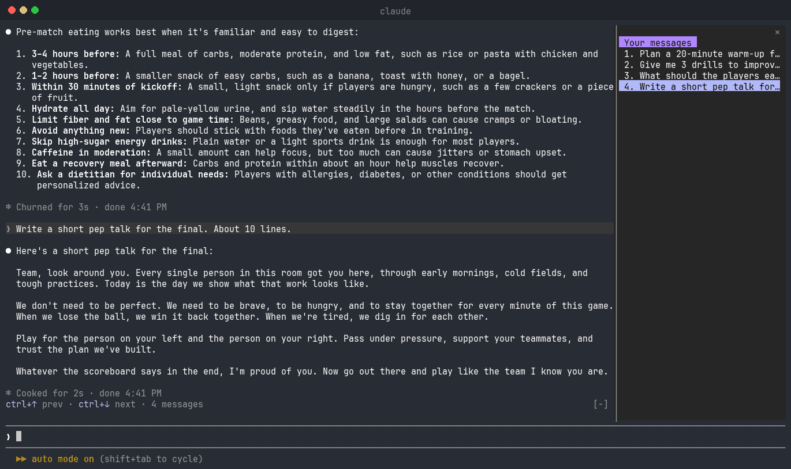

# Claude Code Navigator

Jump between your own messages in Claude Code with Ctrl+↑ / Ctrl+↓.



## Features

- **Ctrl+↑ / Ctrl+↓**: previous / next message, marked with an orange box.
- **Ctrl+↓ after your last message**: back to the latest answer.
- **Side pane**: your messages, one line each. Click one to jump to it.

## Install

```
/plugin install navigator --marketplace etombrof/claude-code-navigator
```

## Requirements

- Fullscreen view: `"tui": "fullscreen"` in `~/.claude/settings.json`
- `python3`

## Notes

- Narrow terminal: `/messages` opens the pane.
- Once you type in the prompt, Claude keeps Ctrl+↑/↓. In kitty, add to `kitty.conf`:

```
map ctrl+up   send_key alt+up
map ctrl+down send_key alt+down
```
